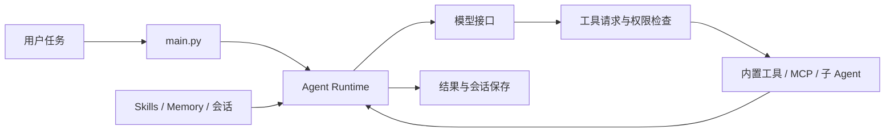

# multiCC · Agent Runtime 学习与复现

基于 Python 的命令行 Agent Runtime，包含模型调用、工具执行、权限检查、Skills、长期记忆、MCP、子 Agent 和会话恢复。

**项目来源：** [Biscuit-AI531/BearCode](https://github.com/Biscuit-AI531/BearCode)。本仓库用于学习与复现，现命名为 `multiCC`；当前整理涉及目录清理、命名统一与说明修正，尚无独立功能开发。原有能力归属于原项目，后续二次开发应通过具体代码、测试和实验结果说明贡献。

当前源码中未见项目级 `LICENSE`；公开再发布前，请先确认原项目的许可或取得原作者授权。

## 已有能力

- **Agent Loop**：构建上下文、调用模型、检查工具权限、执行工具、回写结果并保存会话。
- **双协议接口**：支持 OpenAI-compatible 与 Anthropic-compatible 服务。
- **工具与权限**：文件读写、编辑、搜索、Shell，以及 Plan、自动接受编辑等权限模式。
- **Skills 与记忆**：加载项目级 / 用户级 `SKILL.md`，检索相关技能，按项目组织长期记忆。
- **Skill 演化与在线评测**：从反馈抽取规则，执行 add / merge / discard 决策，记录版本与使用情况；`/skill-eval` 使用运行时记录评测 Skill 演化。
- **扩展与上下文管理**：stdio MCP 客户端、子 Agent、上下文压缩与会话恢复。



## 快速启动

需要 Python 3.11+。启用默认 MCP 服务还需 Node.js / `npx`；`ripgrep` 可提升搜索效率。

Windows PowerShell：

```powershell
python -m venv .venv
.\.venv\Scripts\python.exe -m pip install -r requirements.txt
Copy-Item .env.example .env
# 编辑 .env，填写自己的 API Key、接口地址和模型名称
.\.venv\Scripts\python.exe -m agents.main --help
.\.venv\Scripts\python.exe -m agents.main
```

macOS / Linux：

```bash
python3 -m venv .venv
source .venv/bin/activate
python -m pip install -r requirements.txt
cp .env.example .env
# 编辑 .env，填写自己的 API Key、接口地址和模型名称
python -m agents.main --help
python -m agents.main
```

程序会读取当前目录或父目录的 `.env`。建议仅保留一组提供商配置，避免多组变量影响接口选择。模型名称使用 `MODEL`，命令行 `--model` 的优先级更高。

项目目录名为 `multiCC`，下列命令均在该目录执行。专用接口变量为 `MULTICC_API_KEY`、`MULTICC_API_BASE`；通用变量 `APIKEY` / `API` 仍可使用。

OpenAI-compatible 配置：

```dotenv
OPENAI_API_KEY=your-api-key
OPENAI_BASE_URL=https://your-provider.example/v1
MODEL=your-model-name
```

Anthropic 原生配置可使用 `ANTHROPIC_API_KEY`、`ANTHROPIC_BASE_URL` 和 `MODEL`。通用配置可使用 `APIKEY`、`API` 和 `MODEL`；通用接口路径包含 `/anthropic` 时使用 Anthropic-compatible 协议。

安装依赖并配置 `.env` 后，以下示例使用虚拟环境中的 `python`：

```bash
python -m agents.main "总结这个项目的目录结构和核心模块"
python -m agents.main --plan "分析 Skills 检索逻辑可以如何改进"
python -m agents.main --resume
```

Windows 若未激活环境，将 `python` 替换为 `.\.venv\Scripts\python.exe`。

运行本地回归测试（不调用模型或外部 MCP 服务）：

```bash
python -m unittest discover -s tests -v
```

## 演示案例

`examples/prepare_demo.py` 会生成独立的购物车修复案例，文件位于被 Git 忽略的 `.demo-workspace/`：

```bash
python examples/prepare_demo.py
python -m unittest discover -s .demo-workspace -v
```

修复前有 4 个测试、3 个失败，修复后应全部通过。让 Agent 只修改 `.demo-workspace/cart.py`，保留测试作为验收依据。重复演示时执行 `python examples/prepare_demo.py --reset`，仅重置这两个演示文件。

## Skills 与 MCP

仓库仅附带 `.multicc/skills/code_review/SKILL.md` 作为 Skill 示例。自己的技能可以放在 `.multicc/skills/<name>/SKILL.md` 或 `~/.multicc/skills/<name>/SKILL.md`；默认忽略新增本地技能，公开提交前应单独审查。

Skill 模板可使用 `${MULTICC_SKILL_DIR}` 引用自身目录。项目指令文件使用 `MULTICC.md`，附加规则放在 `.multicc/rules/`，自定义子 Agent 放在 `.multicc/agents/`。用户级配置、记忆、计划和会话统一保存在 `~/.multicc/`。

Skill 自动演化默认开启，可在 `.env` 中设置：

```dotenv
MULTICC_AUTO_SKILL_EVOLUTION=1
MULTICC_AUTO_SKILL_TARGET=project
```

演化写入受当前权限模式控制。可使用 `--accept-edits` 自动接受编辑；`--yolo` 会跳过确认。交互命令包括 `/skills`、`/skill-stats`、`/skill-feedback` 和 `/skill-eval`。

`.mcp.json` 默认配置 Context7 和 Playwright，会通过 `npx` 启动外部服务并可能下载依赖。浏览器操作还需要 Playwright 浏览器组件。只使用内置工具时，可将 `mcpServers` 改成空对象：

```json
{"mcpServers": {}}
```

## 代码导航

| 文件 | 作用 |
| --- | --- |
| `agents/main.py` | CLI、REPL、环境变量与接口选择 |
| `agents/agent.py` | Agent Loop、工具调度、上下文管理 |
| `agents/tools.py` | 工具定义、执行与权限检查 |
| `agents/prompt.py` | 动态构建系统提示词 |
| `agents/skills.py`、`agents/frontmatter.py` | Skill 加载、检索与解析 |
| `agents/online_skill_evolution.py`、`agents/skill_evolution.py` | 反馈抽取、Skill 演化、版本与审计 |
| `agents/online_skill_eval.py` | 基于运行时记录的 Skill 在线评测 |
| `agents/memory.py` | 长期记忆 |
| `agents/session.py`、`agents/session_memory.py` | 会话保存、恢复与压缩记忆 |
| `agents/mcp_client.py`、`agents/subagent.py` | MCP 与子 Agent |
| `agents/ui.py` | 终端输出 |

## 当前限制

- 权限检查发生在应用层，并非操作系统沙箱；显式权限规则会影响 Plan 等模式的行为。执行不可信任务应使用隔离环境。
- 当前测试覆盖命名变更涉及的配置、Skill、会话和 MCP 等行为，尚无固定依赖锁文件或可复现的公开基准跑分。`/skill-eval` 不代表 GAIA、ToolBench 等基准成绩。
- 未被现有运行代码引用的完整评测数据集、个人会话、第三方写作素材和重复讲解文档未包含在整理后的目录中。
- `.env`、虚拟环境和运行时产物应保留在本地；不要提交真实密钥或私人对话。公开发布还需检查 Git 历史，删除当前文件不会删除历史版本。
